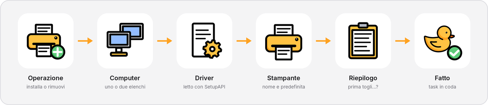
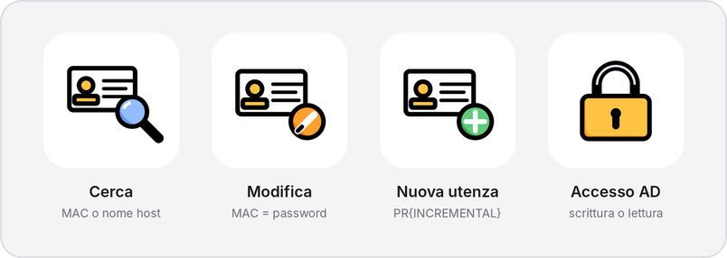

<div align="center">


**Printers on hundreds of PCs, and their MAC accounts in Active Directory, from the same window.**
Paste a list of computers, pick a driver, confirm: every PC gets its task, the ones
that are switched off are retried until they come back. One executable, nothing to install.

[](https://github.com/Zaick99/DuckPrinterManager/releases/latest)
[](https://github.com/Zaick99/DuckPrinterManager/releases)
[](https://github.com/Zaick99/DuckPrinterManager/stargazers)
[](https://github.com/Zaick99/DuckPrinterManager/commits)


[](LICENSE)

[**Download**](https://github.com/Zaick99/DuckPrinterManager/releases/latest) ·
[What it does](#what-it-does) ·
[How it reaches the PCs](#how-it-reaches-the-pcs) ·
[Configuration](#configuration) ·
[Changelog](CHANGELOG.md)

<picture>
  <source media="(prefers-color-scheme: dark)" srcset="docs/images/deploy-flow-dark.png">
  
</picture>

</div>

> The application's interface is in Italian. Every label is quoted here exactly
> as it appears on screen, with its meaning in English.

---

## In one picture

**A deploy is a wizard, not a form.** **Operazione** (install or remove), **Computer**
(the list of PCs), **Driver** (read from the `.inf` the way Windows reads it),
**Stampante** (name and default printer), **Riepilogo** (summary), **Fatto** (done).
Six steps, one decision each, and the summary asks the last question that matters:
should the printer already on that port go first?

**Nothing is lost when a PC is off.** Every PC gets its own task. If the PC does not
answer, the task waits and the PC is pinged again every 10 minutes — with no expiry
and no limit on attempts — until it comes back. Tasks for the same PC run in the order
you created them: a removal followed by an install never runs the other way round.

**MAC accounts are edited where you find them.** Search by MAC in any format or by host
name, read the whole account, change the MAC or the department in place. Changing the
MAC changes the password with it, because for a printer they are the same thing.

<picture>
  <source media="(prefers-color-scheme: dark)" srcset="docs/images/mac-auth-dark.png">
  
</picture>

---

## Download

| File | What it is |
|---|---|
| [`DuckPrinterManager.exe`](https://github.com/Zaick99/DuckPrinterManager/releases/latest) | portable, about 73 MB — the .NET runtime, WPF, the Rust core and the PowerShell scripts in one file. Nothing to install. |

Windows 10 or 11, 64-bit. The binary is not signed, so SmartScreen warns on the
first run — its SHA-256 is in every release.

The first time it starts, open **Impostazioni** (Settings): the values it ships with
are examples (`example.local`, `OU=Printers,...`). See [Configuration](#configuration).

---

## The change of direction

**Duck Printer Manager used to be a single PowerShell script, `start.ps1`. Version 2
is a C# application on .NET 8 that still uses PowerShell for what PowerShell is
good at.**

Each part of the job goes to the tool that does it best:

| | Version 1 | Version 2 |
|---|---|---|
| Interface | WPF built from XAML strings in a script | WPF in C#, a wizard per job, light and dark theme |
| Commands on the PCs | PowerShell | PowerShell — the same cmdlets, now in separate scripts with a fixed protocol |
| Task queue and memory | script variables | a Rust core (`duck_core`): per-PC FIFO, retries, duplicates, log ring buffer, secrets zeroed on removal |
| Reading drivers | a text parser | **SetupAPI**, the engine Windows itself uses, with the text parser as a fallback |

The configuration file keeps the same keys: an old `duck_config.json` placed next to
the executable is imported on first start.

---

## What it does

### Deploy — **Deploy stampanti**

- **Lists of PCs pasted from anywhere** — lines, spaces, commas, semicolons, Excel
  columns. Names are validated and de-duplicated as you type.
- **Two lists when installing**: **Con stampante predefinita** (the printer becomes the
  default) and **Installazione normale**. When you paste, a name ending in `*` goes to
  the first list on its own. **When removing there is one list**, and the paste puts
  everything in it.
- **Drivers read with SetupAPI**: encodings, continued lines, localised `[Strings]`,
  architecture decorations — as Windows interprets them. A single `.inf` or a whole
  driver folder; drag and drop works.
- **Printer name from a template**: `{DRIVERNAME}` becomes the driver's name, the rest
  stays as written — `{DRIVERNAME} (PR0042)`. `{IP}` and `{DATE}` too.
- **Default printer** four ways: **Automatica** (set_prt if present, otherwise Windows),
  **set_prt**, **Windows**, **Entrambe** (both). set_prt is updated in every version
  installed on the PC; Windows' default is set inside the session of the user logged in.
- **Removal by port**: every queue whose port points at the given IP, host name or
  FQDN goes, whatever the port is called (`IP_x`, FQDN, IPP URL). The match is exact:
  `10.1.1.5` does not touch `10.1.1.50`. Or every network printer, with local and
  virtual ones left alone.
- **Remove before install**: in the summary, **Prima di installare** offers the printer
  on the same port, another address, or every network printer.
- **When**: **Subito** (now), in 30 minutes, in an hour, tonight at 20:00, tomorrow at 07:00.
- **Starting values**: **Impostazioni → Procedura** decides which options the wizard
  opens with, for installs and for removals — set them once and a repeated deploy is
  a list and a confirmation.

### Scheduled tasks — **Task programmati**

A live table with counters that double as filters, a completion chart that updates in
real time (5 minutes, 30 minutes, 2 hours), search, and a selection bar. Run now,
pause and resume — one task or the whole scheduler — edit, stop, delete; clear the
completed, the expired, the failed, the **duplicates**. Double-click a task for its own
log window, updating while it runs.

### MAC Auth

- **Sign in to Active Directory** once. If the account has rights on the printers' OU
  (read from the OU's ACL against the account's groups), editing and creating are on;
  otherwise the page is read-only, and says so.
- **Search** by MAC in any format (`00:11:22:aa:bb:cc`, `0011.22aa.bbcc`, ...) or by host
  name. A name that is not in AD is resolved through DNS, pinged, and its MAC read from
  the ARP cache.
- **The whole account on one card**: SAM, UPN, OU, department, enabled, locked, groups
  and the groups it should have but does not — and an automatic **sign-in test** with
  user = MAC, password = MAC, skipped when one more failure would lock the account.
- **Edit in place**: the MAC is always lowercase with no separators, replaced on every
  attribute that contains it, with SAM, UPN and password aligned. Operations use the
  object's GUID, so a renamed object is still the same object.
- **New account** as a wizard: MAC → department → confirm. The name follows the
  pattern (`PR{INCREMENTAL}`) and is recomputed on every attempt, in case a colleague
  took the same number a second earlier.
- **Delete** from the card, after a confirmation that names the object — only inside
  the configured OU, and only if the account has not changed since you looked at it.
- **Departments** come from a text file on a share, with suggestions as you type and,
  optionally, only values from the list.

### Log

Everything the application does, live: counters for events, warnings and errors,
filters, copy, and the log file on disk with 5 MB rotation.

### Settings — **Impostazioni**

**Active Directory** (domain, OU, the domain controller to write to), **Nuove utenze**
(name pattern, temporary password stored with DPAPI, groups), **Deploy** (accounts,
driver cache, set_prt folders, working folder on the PCs), **Procedura** (the wizard's
starting values), **Task e sistema** (parallel tasks, retry interval, back-off, expiry,
timeouts, theme, glass, ducks, PowerShell path).

### The look

Light and dark that switch without a flash, an optional glass window with Windows'
own blur behind it, illustrations in place of icon fonts, and an avatar for whoever
signs in: a duck dressed according to the first letter of their name.

<picture>
  <source media="(prefers-color-scheme: dark)" srcset="docs/images/avatars-dark.png">
  
</picture>

---

## How it reaches the PCs

```
┌───────────── WPF (.NET 8) ─────────────┐    P/Invoke (C ABI, JSON)    ┌──────── duck_core (Rust) ────────┐
│ Deploy · Task · MAC Auth · Log · Impo. │ ───────────────────────────▶ │ task queue, per-PC FIFO          │
│ scheduler (1 s loop, N in parallel)    │                              │ log ring buffer (global/task)    │
│ SetupAPI INF reader · driver cache     │                              │ session secrets, zeroed on drop  │
└───────────────┬────────────────────────┘                              │ host and MAC parsing             │
                │ pwsh / powershell process (stdin: base64 JSON · stdout: ##LOG / ##RESULT)
                ▼
   HostWorker.ps1 ──WinRM──▶ RemoteDeploy.ps1 / RemoteRemove.ps1 (on the PC)     Ad.ps1 (RSAT + ADSI)
               └──WMI/DCOM + SMB (fallback)
```

Every step has a second way when the first one fails:

| Step | First | Then |
|---|---|---|
| Account | the AD account you signed in with | your Windows account (order configurable) — the next one is tried only on *access denied* |
| Transport | WinRM | WMI/DCOM with the files on the admin share |
| Driver files | SMB (`\\pc\C$`) | `Copy-Item -ToSession` |
| Driver install | `pnputil` + driver store | `Add-PrinterDriver`, `printui /ia`, `pnputil /subdirs`, DISM |
| Port | `Add-PrinterPort` | WMI |
| Queue | `Add-Printer` | `printui /if`, WMI `Win32_Printer` |

When every account gets *access denied*, the task says so in plain words — the account
must be a local administrator of the PC — and as soon as you sign in to AD those tasks
are retried at once.

---

## Requirements

- Windows 10 or 11, 64-bit, for the operator's PC.
- PowerShell 7 recommended; Windows PowerShell 5.1 works.
- For **MAC Auth**: RSAT Active Directory —
  `Add-WindowsCapability -Online -Name Rsat.ActiveDirectory.DS-LDS.Tools~~~~0.0.1.0`
- On the target PCs: WinRM, **or** the `C$` share plus DCOM/WMI; an account that is a
  local administrator.

---

## Configuration

The defaults in the code are **examples**, not anyone's real environment:

| Setting | Example value |
|---|---|
| Domain | `example.local` |
| Printers' OU | `OU=Printers,OU=MAC Authentication,DC=example,DC=local` |
| Groups for new accounts | `MAC-Auth Printers` |
| Departments file | `\\fileserver\share\config\reparti.txt` |
| set_prt folder · process | `C:\set_prt` · `set_prt_agent` |

Set the real ones in **Impostazioni** on first start. They are saved in
`duck_config.json` on the operator's PC and never end up in the repository.

---

## Where the data lives

```
%LOCALAPPDATA%\Duck\PrinterManager\
  duck_config.json            settings (passwords protected with DPAPI)
  duck_tasks.json  (+ .bak)   the task queue, written atomically
  duck_printer_manager.log    log, rotated at 5 MB
  _driver_cache\              copies of the drivers used by queued tasks
  ps\                         the PowerShell scripts, extracted at start
%APPDATA%\Duck\theme          light / dark / system
```

The AD password lives only in memory, inside the Rust core, and is zeroed when you
sign out or close the application.

---

## Building

```powershell
.\build.ps1                  # Rust core + publish to .\dist
.\build.ps1 -SelfContained   # with the .NET runtime included
```

Needs the .NET 8 SDK and Rust (`rustup`, MSVC target). The portable single file —
build the Rust core first, the project picks up `duck_core.dll` on its own:

```powershell
cargo build --release --manifest-path native/duck_core/Cargo.toml
dotnet publish src/DuckPrinterManager -c Release -o dist --self-contained true `
  -p:PublishSingleFile=true -p:IncludeNativeLibrariesForSelfExtract=true `
  -p:EnableCompressionInSingleFile=true -p:DebugType=none
```

Releases are built the same way by GitHub Actions (`.github/workflows/release.yml`)
when `<Version>` in the project changes.

---

## Project layout

```
native/duck_core               Rust: task queue, scheduler state, log, secrets, host/MAC parsing
src/DuckPrinterManager.Core    .NET without UI: P/Invoke, PowerShell runner, SetupAPI reader,
                               AD service, configuration; Scripts/*.ps1 run on the PCs and in AD
src/DuckPrinterManager         the WPF application: pages, dialogs, theme, animations
assets/                        icon (duck.png, duck.ico) and the logo of this page
docs/                          the pictures in this page and the release notes
.github/workflows/release.yml  builds the executable and publishes the release
```

---

## A note on use

This is an administration tool: it installs and removes software on other computers
and edits Active Directory. Use it **on infrastructure you manage, or where you are
authorised to**.

---

## Stars over time

<div align="center">

<a href="https://star-history.com/#Zaick99/DuckPrinterManager&Date">
  <picture>
    <source media="(prefers-color-scheme: dark)" srcset="https://api.star-history.com/svg?repos=Zaick99/DuckPrinterManager&type=Date&theme=dark">
    
  </picture>
</a>

</div>

---

## License

MIT — see [LICENSE](LICENSE). Use it, change it, ship it; keep the copyright notice.
The duck, the illustrations and the avatars are by Zaick.
